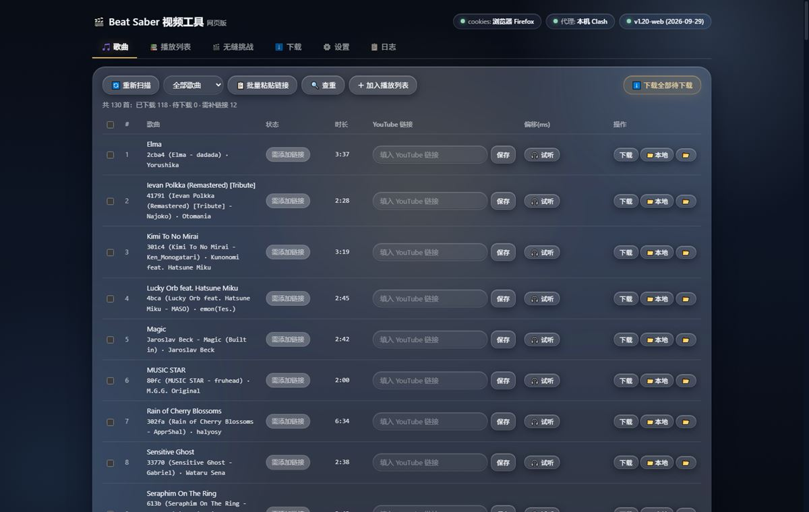
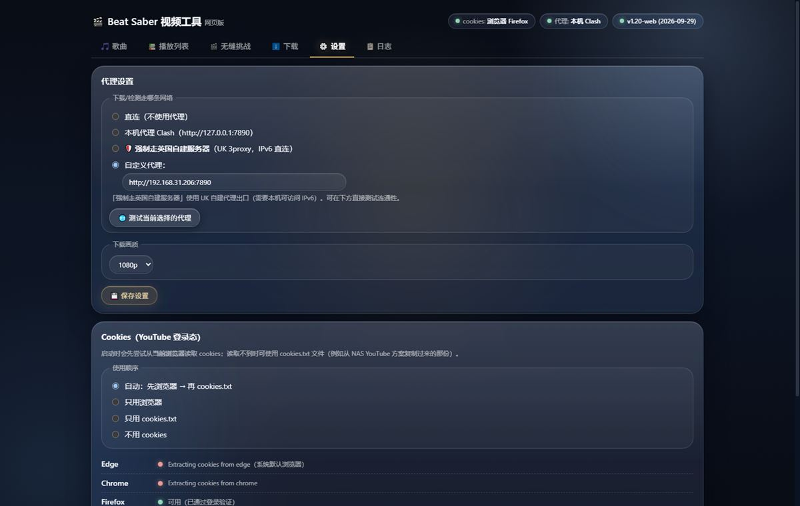
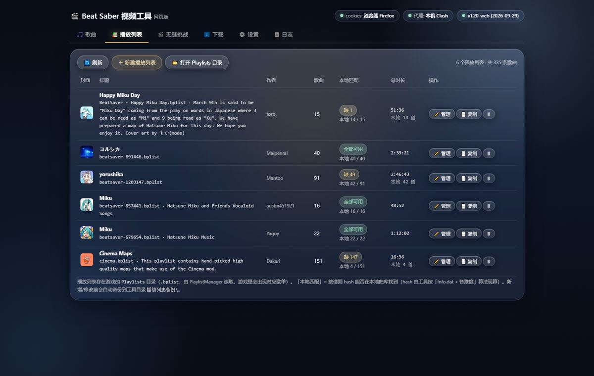

# Beat Saber 视频工具 · 网页版

本地网页界面（浏览器操作），给 **Beat Saber 自定义歌曲**批量配置背景视频（配合 **Cinema** / **Theater** mod + yt-dlp）。

- 🎵 **歌曲总览**：已下载 / 待下载 / 需补链接
- 🔗 **补链接**：页面里直接粘贴 YouTube 链接
- ⬇️ **一键批量下载**：实时进度、日志、可停止（yt-dlp → ffmpeg → 写配置）
- 🎬 **试看 + 偏移调整**：频谱对比、自动对齐、左右耳分离
- 🍪 **Cookies 管理**：自动探测本机浏览器 / cookies.txt / 粘贴 / URL 拉取
- 🌐 **代理**：直连 / 本机代理 / 自定义（**默认直连**，不内置任何代理地址）
- 📋 **播放列表**：基于本地谱面建歌单、批量加歌、编辑/复制/删除（.bplist）
- 🎥 **同时兼容 Cinema 与 Theater**：自动识别并写 cinema-video.json / theater-video.json

**支持版本**：Beat Saber 1.40.x – 1.44.x（Cinema 全系；Theater v1.17）
**运行环境**：Windows / macOS / Linux + Node.js 18+

## 配套项目

这三个仓库是同一套 Beat Saber 工具链，按需取用：

| 项目 | 作用 | 何时需要 |
|---|---|---|
| **[SetlistChallenge](https://github.com/EuphonXD/SetlistChallenge)** | 无缝连打 mod（场景内换谱） | 想用本工具的 **🎬 无缝挑战** 页：工具会把挑战配置写进 `UserData\\SetlistChallenge\\*.json`，装了这个 mod 游戏内才能读 |
| **[yt-pot-helper](https://github.com/EuphonXD/yt-pot-helper)** | YouTube PoToken 一键助手 | 批量下载报 *Sign in to confirm you’re not a bot* 时，在本机起一个 PoToken 服务给 yt-dlp 用 |
| **Cinema / Theater**（游戏 mod） | 视频播放 | 必需：本工具只负责下载与写配置，播放靠它 |

---

---
## 界面预览

### 🎵 歌曲总览（状态 / 时长 / YouTube 链接 / 偏移）

### ⚙️ 设置（代理 / 视频高度 / Cookies）

### 📚 播放列表（基于本地谱面建歌单）

---

# Beat Saber 视频工具 · 网页版 使用说明

本地网页界面（浏览器操作），用于：
- 总览全部歌曲的视频状态（已下载 / 待下载 / 需补链接）
- 在页面里直接**补充 YouTube 链接**
- **试看视频并调整偏移**（频谱对比 + 自动对齐 + 左右耳分离）
- **一键批量下载**（实时进度、日志、可停止）
- **Cookies 管理**：启动时自动尝试读取本机浏览器；也支持 cookies.txt / 粘贴 / URL 拉取
- **播放列表管理**：基于本地谱面快速建歌单、批量加歌、编辑/复制/删除（PlaylistManager 的 `.bplist`）；歌单里「本地没有」的歌可**一键从 BeatSaver 补下**
- **同时兼容 Cinema 和 Theater（v1.17）**：视频配置自动识别/写入 `cinema-video.json` 或 `theater-video.json`，并替 Theater 登记 `downloadedFormats`

---

## 启动

1. 双击工具目录里的 **`启动网页版.bat`**
2. 浏览器会自动打开 `http://127.0.0.1:8770`
   （若 8770 被占用会自动换成 8771、8772…，以黑色窗口里显示的地址为准）
3. 关闭那个黑色窗口 = 停止服务

> 运行要求：Node.js（已安装过）。服务只监听本机 127.0.0.1，不对局域网/外网开放。

---

## 页面说明

### 🎵 歌曲
- 状态说明：
  - **已下载**：歌曲目录里已有视频文件
  - **待下载·有链接**：已有 videoID 或链接，等待下载
  - **待下载·无链接 / 需添加链接**：需要补 YouTube 链接
- **列表排序**：分三档 —— ① **没有视频的歌**排最上面；② 其次 **偏移为 0ms 的**（有视频但还没调偏移）；③ 其余（已调过偏移的）。每档内部按**歌曲名首字母**排序（数字开头 → A-Z → 中文/日文）；序号列按当前排序位置重排。
- **补链接**：每行"YouTube 链接"栏粘贴后点【保存】；也可以点工具栏【批量粘贴链接】：
  - 每行一条，格式：`序号 | 链接` 或 `文件夹名 | 链接`（也支持空格分隔）
- **偏移(ms)**：列表里只是**显示**当前偏移（整数毫秒，与游戏内 Cinema 完全一致）；
  **调整偏移请点【🎬 试看】**，在试看窗口里改（见下）。
- **操作**：`🎬 试看`（有视频时）· `🎧 试听`（没视频时：只听歌曲音频，用来确认是哪首歌，不改任何文件）· `📁 本地`（用本地视频）· `下载`（单个）· `重下`（强制覆盖）· `📂`（打开歌曲文件夹）
- **🔍 查重**（工具栏）：按**文件夹名开头的 ID** 查重，例如 `10af0 (mousou zei - Dack)` 的 ID 是 `10af0`；同一 ID 的多个文件夹就是重复谱面（**不做音频分析，秒出**）。
  - 结果里可直接 **🎬 试看 / 🎧 试听** / **📂 打开文件夹**；重复的可以 **🗑 移出**（单个）或 **「只留第 1 个，其余移出」**（整组）。
  - 移出 = 把歌曲文件夹挪到 `Beat Saber_Data\CustomLevels_已删除\`（不直接删，可恢复；确认后可手动清空）。
  - 只对"像 ID 的前缀"（4~8 位字母数字且含数字）生效，官方 OST（(Built in)）不计入，避免把同作者的歌误判。
- **📁 本地视频**：点「📁 本地」选一个本机视频文件给这首歌（不用去 YouTube 下）。
  - 支持 `mp4 / webm / mkv / mov / m4v / avi`；**非 mp4 会自动转码**成游戏能播的格式（大文件会等一会儿，别关窗口）
  - 工具会把视频整理成歌曲目录里的 `video.mp4`（H.264 + AAC），并自动写好 `cinema-video.json`（含 Cinema 必需的 `videoID`，本地视频用的是每首唯一的 `local-xxxxxxxxxx`，不会被当成 YouTube 链接）
  - 放好后游戏里选中这首歌就能看到视频了（试看窗口里照样能调偏移）

### 📚 播放列表
在**游戏外**直接管理 PlaylistManager 的歌单（就是游戏目录 `Playlists\` 里的 `.bplist`）：

- **歌单列表**：显示每个歌单的标题/作者/歌曲数，以及「本地匹配」（歌单里的歌有多少能在本地曲库找到）。
  每行操作：`✏️ 管理`（编辑）· `📄 复制`（另存副本）· `🗑`（删除，删前自动备份）。
- **＋ 新建播放列表**：填标题/作者/描述 → 【＋ 选择歌曲…】挑歌 → 【创建】。
- **选歌器**：可搜歌名/文件夹/作者，按「全部 / 无视频 / 有视频」筛选，有【➕ 全选筛选结果】【全不选】。
  常见玩法：先筛「无视频」→ 全选 → 建一个「待补视频」歌单。
- **管理（编辑歌单）**：改标题/作者/描述；条目可 `↑` `↓` 调顺序、`✕` 移除；【＋ 添加歌曲…】继续加歌；
  【🧹 移除「本地没有」的条目】清理失效项；`🎬`/`🎧` 可直接试看/试听该条。**改完必须点【💾 保存】才写入**。
- **从歌曲页快速加**：在「🎵 歌曲」页左侧勾选若干首（表头复选框可全选）→ 工具栏【＋ 加入播放列表】→ 选歌单加入，或【＋ 新建并加入…】。
- **补下缺失的歌**（歌单里显示「本地没有」的）：
  - 单条：每条右边有 **⬇ 下载** —— 从 BeatSaver 下这首谱面（zip 解开丢进 `CustomLevels\`）
  - 批量：工具栏 **⬇ 下载全部缺失 (N)** —— 一次把歌单里所有本地没有的补完，下面会显示实时进度（`正在下载 3/41 · 安装 2 · 跳过 1 · 失败 0`）
  - 定位方式：优先用条目的 `key`（BeatSaver 谱面ID），没有 key 时用 `hash`（`api.beatsaver.com/maps/ids|hash/...`）；两者都没有的条目会标「无 key/hash」不能下载
  - 已经存在的（哪怕文件夹名不同、用 key/hash 比对）会直接**跳过**，不会重复装；下载完的谱面会按 `<key> (<歌名> - <作者>)` 命名文件夹
  - 走工具设置里的代理（设置页那个）；下完后**需要在游戏里刷新歌曲（或重启游戏）**才会出现
- **匹配依据**：谱面 hash（工具现算：`sha1(Info.dat 原始字节 + 按 Info 顺序的各难度 .dat)`，与 PlaylistManager 一致），同时保留 BeatSaver 的 `key`。
- **安全**：新增/修改/删除歌单前都会在工具目录 `播放列表备份\` 存一份 `文件名.bak_时间戳`。

### 🎬 视频 mod：Cinema / Theater 兼容（v1.17）
游戏 1.27 以后 Cinema 停更，后继是 **Theater**（`theater-video.json`）。两者配置文件字段基本一致（`offset` 毫秒 / `videoID` / `videoUrl`），差别在“怎么算已下载”：
- Cinema 只看 `videoFile`；**Theater 默认按 `"<title>.mp4"` / `"<videoID>.mp4"` 找文件**，老式的 `video.mp4` 必须在配置里显式登记
  `"downloadedFormats": { "Mp4": "<视频文件绝对路径>" }` 才认
- 本工具从 v1.17 起自动处理：
  - 读/写配置时按规则选文件（有 `cinema-video.json` 就用它，否则用 `theater-video.json`）
  - 改偏移时顺手补全 `downloadedFormats`（老视频“复活”）
  - 下载视频 / 放本地视频 / 删视频 / 删音频 都同步维护这个字段
  - 只有视频、没配置的歌：在工具里调一次偏移就会自动生成正确的配置

### 🎬 试看弹窗（偏移调整 / 频谱对比 / 自动对齐）

点列表里的 **🎬 试看** 打开：

- **左侧视频**：可直接用播放器控件看画面；**频谱对比图在下方一整条**（宽度与界面同宽、高度压缩）：
  - 上半 = 视频音频（青色）
  - 下半 = 谱面音频（橙色，即游戏里听到的 `song.egg`）
  - 两条对齐时，拍点/鼓点应上下对称出现
- **▶ 播放 / ⏸ 暂停**：左右两路音频会**自动保持同步**（内部以谱面时间为基准，视频按偏移跟随）。
- **偏移调整**（单位 **ms，整数**）：
  - 按钮：`−1000 / −100 / −20 / −10` 与 `+10 / +20 / +100 / +1000`，也可以在输入框直接改数字
  - 正负含义与游戏内一致：**负值 = 视频更晚出现（starts video later）**，正值 = 视频更早出现
  - 改完点 **💾 保存偏移** 写入该歌曲的 `cinema-video.json`（和游戏内 Cinema 菜单改的是同一个值）
- **🪄 自动对齐**：点一下会解码两条音轨、自动算出建议偏移，并**立即应用到试看**（不会自动保存，满意后再点💾保存）。
  结果会显示置信度与峰值，置信度低时建议再手动微调。
- **🎧 左右耳分离**：勾选后 **左耳只放视频声音、右耳只放谱面声音**（戴耳机用），
  方便靠听感把两边拍点对到一起 —— 对齐完美时两耳听到的就是同一个节拍。
- **音量**：可分别调视频/谱面音量；设置会自动记住（下次打开沿用）。
- **当前视频维护**：
  - **🔇 删除音频**：去掉视频里的声音轨道（画面保留），能省一点体积；游戏里 Cinema 本来就是只放画面。
  - **🗑 删除视频**：删掉这首歌的视频文件和 `cinema-video.json`（不可恢复，会二次确认）。
- **游戏内谱面预览**（3D，**在视频右侧**）：把谱面实际画出来，音符朝你飞来——
  - 每个方块上有**箭头**：箭头指向哪边就代表往哪切（含斜向箭头；圆点=任意方向）
  - 上方可选难度（默认最难），旁边显示 BPM / 音符数 / 炸弹 / 围墙 / 平均 NPS / NJS
  - 红/蓝方块=音符（块内箭头=切割方向）、半透明块=围墙、黑方块=炸弹；地面黄线=当前播放位置
  - **GPU 可用时自动走 WebGL 加速**（统计行会显示「3D·GPU(WebGL)」）；不可用时自动回落软件 3D（「3D·CPU(软件)」）
  - **点音符可跳到该时间点**；取消「随播放滚动」可定格查看
  - **受击即消失**：方块越过受击线后就消失（和游戏一致）
  - **🥁 打击音效**：音符到线上的瞬间发一声清脆的打击声（Web Audio 合成，红/蓝音高不同，好辨认），旁边滑块调音量；用来对照视频对拍点很直观
  - 相机离受击线有一定距离（视角比较平缓，能看到音符飞来的过程）；**所有谱面设置都在谱面窗口下方**
  - **帧数档位**：30 / 60 / 90 / 120 / 不限（右侧会显示实际帧率）；卡的话调低一档
  - 谱面窗口是 **16:9** 比例（居中显示，最大 720px 宽）；视频区高度调矮了一些，避免弹窗太长

> 首次点某个歌曲的试看时，会自动把视频音轨与谱面音轨各提取成一个 mp3 缓存（
> 存放在工具目录的 `缓存音频\` 下），所以第一次可能等几秒；之后秒开。
> 缓存以源文件修改时间为准，视频/谱面换了会自动重建。

### ⬇️ 下载
- 显示当前任务、队列、成功/跳过/失败统计、实时日志
- 【停止任务】可中断当前下载
- 已有视频默认跳过；「重下」或下载页的强制模式会覆盖

### ⚙️ 设置
- **代理**（三选一）：
  - 直连
  - 本机代理（如 http://127.0.0.1:7890）
  - 自定义（支持 `http://`、`socks5://`）
  - 可点【测试当前选择的代理】验证连通
- **Cookies**：
  - 启动时优先尝试当前浏览器（系统默认浏览器优先，其次 Edge/Chrome/Firefox）
  - 读不到时用工具目录下的 `cookies.txt`（如从 NAS YouTube 方案复制过来的那份）
  - 也支持：导入文件 / 粘贴文本 / 从 URL 拉取
  - 使用顺序可切换：自动 / 仅浏览器 / 仅 cookies.txt / 不用
- 下载画质：720p / 1080p / 1440p

### 📋 日志
- 最近日志；完整日志同时写入 `日志\网页版日志.txt`

---

## 常见问题

- **用了「📁 本地」但游戏里看不到视频**：
  - 视频文件必须是歌曲目录下的 `video.mp4`，且 `cinema-video.json` 里要有 `videoID`（或 `videoUrl`）——
    Cinema 只要这两个字段都空就直接当「未下载」，游戏里不显示。新版本工具会自动处理这两点。
  - 视频编码必须是 **H.264**（mp4 容器），其它编码（H.265/VP9/AV1）Unity 播不了 → 会黑屏/没画面。
    工具现在会自动转码；如果用的是旧版本工具放进去的，删掉 `📁 本地` 重新放一次即可。
  - 放好视频后如果游戏已经开着，退到主菜单重进这首歌即可。

- **浏览器 cookies 读取失败**：新版 Chrome/Edge 有加密限制，或浏览器里没登录 YouTube。
  → 改用 `cookies.txt`（从 NAS 方案复制，或手动导出）。
- **下载报 "Sign in to confirm you're not a bot"**：cookies 失效/缺失 → 重新导入 cookies 或重新检测。
- **英国代理连不上**：确认本机 IPv6 可用（该代理是 IPv6 地址）；换回本机 Clash 或直连测试对比。
- **试看没有声音 / 频谱不动**：点一下【▶ 播放】（浏览器要求先有用户操作才允许出声）。
- **自动对齐结果不太准**：会自动跳到最像对齐的位置让你听；个别视频（剪辑/短版/音轨差异大）可能偏差较大，
  按提示手动 ±[10/20] 细调即可。置信度「低」时要特别留意。
- **启动窗口一闪而过 / 语法报错**：把窗口里的报错信息发给助手处理。
- **端口变化**：以黑色窗口显示的地址为准（自动避让占用端口）。

---

## 与命令行版的关系

- 网页版与 `1-扫描歌曲.bat / 2-下载视频.bat / 3-查看状态.bat`（bs-video.ps1）**互不影响**，可同时存在。
- 共用 `工具配置.json`：网页版保存设置时会同步 `代理` 与 `cookie文件` 字段，命令行版也能享受到配置。
- 链接文件 `视频链接.txt` 两边共用同一份。

*v1.14-web · 2026-09-25（歌曲列表排序：无视频置顶 → 0ms 偏移 → 其余按歌名首字母；试看：偏移调整/频谱对比（全宽条）/自动对齐/左右耳分离；3D 谱面预览 16:9 位于视频右侧（WebGL/GPU 优先）受击即消失 + 方向箭头 + 清脆打击音效 + 帧数档位；无视频的歌显示「🎧 试听」；「📁 本地视频」修复；「🔇 删除音频」「🗑 删除视频」；「🔍 查重（按文件夹 ID）」+ 快捷移出重复）*
